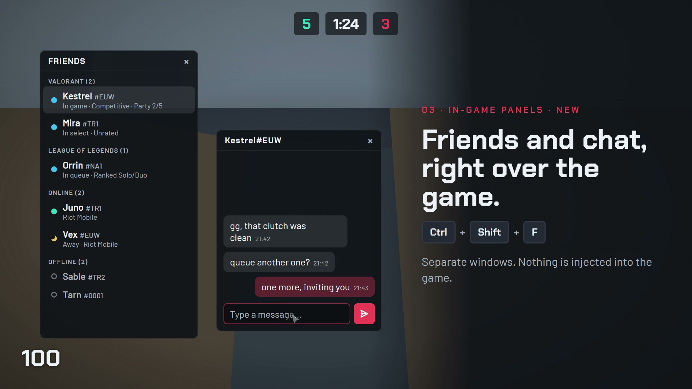

<a id="top"></a>

<div align="center">

<picture>
  <source media="(prefers-color-scheme: dark)" srcset="docs/brand/wordmark-dark.svg">
  
</picture>

**Valorant stats, match history and live match intel — as a fast, private desktop app.**

[🇹🇷 Türkçe](#tr) · [🇬🇧 English](#en)

[](https://github.com/Gurkankaradag0/ClutchBoard/releases/latest)
[](https://github.com/Gurkankaradag0/ClutchBoard/releases)


https://github.com/user-attachments/assets/d259fb73-8e28-433f-ae3d-b3fa6c15df0d

</div>

---

<a id="tr"></a>

## 🇹🇷 Türkçe

ClutchBoard, [tracker.gg](https://tracker.gg/valorant) tarzında bir Valorant istatistik uygulamasıdır: bir Riot ID ara, rank geçmişini, sezon istatistiklerini, maçlarını ve birlikte oynadığı oyuncuları gör. Masaüstünde çalışır, verileri yalnızca senin bilgisayarında tutar.

### Özellikler

- **Profil** — güncel ve en yüksek rank, önceki aktlar, fareyle gezilebilen KP (rekabet puanı) grafiği, sezon özeti (K/D, kazanma %, HS %, Performans Puanı), ajan / harita / silah dağılımı.
- **Maç geçmişi** — günlere gruplu liste, "Daha fazla yükle" ile geriye doğru sayfalama. Maçlar diske kaydedilir: bir oyuncuyu tekrar açtığında yüklenmiş maçları anında görürsün, aradaki yeni maçlar arka planda kendiliğinden çekilir.
- **Maç detayı** — iki takımın skor tablosu (Performans Puanı, ACS, KAST, ilk kill/ölüm, çoklu kill), birlikte sıraya giren oyuncular için renkli şerit, round round öldürme akışı.
- **Riot Performans Puanı** — yama 13.06 ile ACS'nin yerini alan 0–500 puan ve notu (Geçer / İyi / Üstün / Ustaca); eski maçlarda ACS.
- **Oyuncular** — karşılaştığın herkes, "birlikte / maç" sayısıyla (örn. 5/7); tıklayınca o oyuncuyla oynadığın maçlar açılır.
- **Arama** — son aramalar ve favoriler, açtığın maçlardaki oyunculardan oluşan otomatik tamamlama.
- **Valorant açıkken** — **Hesabım**: kuşandığın skinler, kart, seviye ve sprey çarkı, oyun içi satın alma menüsü düzeninde. **Canlı Maç**: maçtaki oyuncuların rank'ı, partileri ve skinleri.
- **Oyun Ayarları** — bu bilgisayarda giriş yapılmış tüm Valorant hesaplarının ayarları tek yerde: nişangah, tuş atamaları (ajana özel profiller dahil), fare, ses ve görüntü. Hesaplar arasında kopyala, ön ayar olarak kaydet, JSON dışa / içe aktar; varsayılan ön ayar bir sonraki giriş yapan hesaba otomatik uygulanır.
- **Oyun içi paneller** — oyunun üstünde duran ayrı pencereler, kısayolla açılıp kapanır. **Canlı maç** (Ctrl+Shift+L) ve **Arkadaşlar** (Ctrl+Shift+F): arkadaşlar Valorant / League of Legends / TFT / çevrimiçi / çevrimdışı diye gruplanır; kim oyunda, sırada ya da seçim ekranında, hangi modda ve kaç kişilik grupta görünür. Bir arkadaşa tıklayınca ona ayrı bir mesaj penceresi açılır; Enter gönderir ve klavyeyi oyuna geri verir, Esc göndermeden geri döner. Paneller sürüklenip boyutlandırılabilir, yerleri hatırlanır; kısayollar ve opaklık **Ayarlar → Oyun içi paneller**'de. Valorant **Pencereli tam ekran**dayken görünür.
- **Nişangah editörü** — canlı önizleme, renk seçici, dış çizgi rengi (glow), nişangah kodunu kopyala veya koddan ekle. Mevcut profiller bozulmaz; yeni nişangah boş bir yere eklenip seçilir.
- **Türkçe / İngilizce**, uygulama içi otomatik güncelleme, kapatınca sistem tepsisinde çalışmaya devam eder.

<p align="center"></p>

### Kurulum

1. **[ClutchBoard-Setup.exe](https://github.com/Gurkankaradag0/ClutchBoard/releases/latest/download/ClutchBoard-Setup.exe)** dosyasını indir ve çalıştır. Kurulum tek tıkla yapılır, bitince uygulama açılır.
2. Bir **HenrikDev API anahtarı** al (ücretsiz): [HenrikDev panelini](https://api.henrikdev.xyz/dashboard/) aç, soldaki **API Keys** bölümünden **Generate New Key** formunu doldur.
3. Uygulamada **Ayarlar → HenrikDev API anahtarı** alanına yapıştırıp kaydet.

Uygulama her açılışta önce güncellemeleri kontrol eder, varsa kurup öyle açılır; **Ayarlar → Güncelleme** üzerinden elle de bakabilirsin. Windows açılınca simge durumunda başlar; **Ayarlar → Başlangıç**'tan kapatılabilir.

### Gizlilik

- API anahtarın, arama geçmişin ve kaydedilen maçlar yalnızca bilgisayarında tutulur (`%APPDATA%` / `%LOCALAPPDATA%`). Hiçbir sunucuya gönderilmez.
- Bir aramayı **X** ile silmek o oyuncunun kaydedilmiş maçlarını ve önbelleğini de siler. **Ayarlar** ekranında her grubun diskte kapladığı alan görünür.

### Yerel Riot Client özellikleri hakkında

"Hesabım" ve "Canlı Maç", Riot Client'ın bilgisayarındaki yerel arayüzünü **yalnızca okur** (Riot Client'ın kendi kullandığı uçlar). İki istisna vardır: **Oyun Ayarları** yalnız Riot Client'a giriş yapılı hesabın kendi ayarlarını, oyunun ayar menüsünün kullandığı servise yazar ve her değişiklikten önce yedek alır (diğer hesapların görüntü ayarları kendi yerel dosyalarına yazılır); **mesaj pencereleri** yalnız senin yazdığın mesajı, yalnız arkadaş listendeki kişiye, Riot Client'ın kendi sohbet bağlantısından gönderir. Oyun içi paneller oyunun üstünde duran ayrı pencerelerdir: oyuna hiçbir şey enjekte edilmez, oyunun belleğine dokunulmaz, oyun içi hiçbir şey otomatikleştirilmez (ajan seçme/kilitleme, otomatik mesaj yok). Gizli isimli oyuncuların adı yalnızca sen istersen, tek tek sorgulanır. Bu özellikleri kullanmak senin sorumluluğundadır.

### Kaynaktan derleme

Gereksinimler: [Bun](https://bun.sh), [Rust](https://rustup.rs) (stable), Windows'ta WebView2 (Windows 10/11'de hazır gelir).

```bash
bun install
echo HDEV_API_KEY=anahtarın > .env      # yalnız geliştirme sürümünde okunur, release'e gömülmez
bun run tauri dev                        # geliştirme
bun run typecheck                        # tip kontrolü
bun run format                           # Tailwind sınıf düzeltmesi + Prettier
```

Yayın akışı (bakımcılar için): `bun run set-version patch` → `bun run release -- "sürüm notu"` → `release/` içindeki üç dosyayı (`ClutchBoard-Setup.exe`, NSIS installer, `latest.json`) yeni bir GitHub Release'e ekle.

**Teknolojiler:** Tauri v2 (Rust) · React 19 · TypeScript · Tailwind CSS 4 · shadcn/ui · TanStack Query · Zustand · i18next. Veri: [HenrikDev API](https://docs.henrikdev.xyz), görseller: [valorant-api.com](https://valorant-api.com).

**Lisans:** [MIT](LICENSE)

[⬆ Başa dön](#top)

---

<a id="en"></a>

## 🇬🇧 English

ClutchBoard is a [tracker.gg](https://tracker.gg/valorant)-style Valorant stats app: search a Riot ID and see rank history, season stats, matches and the players they queue with. It runs on your desktop and keeps your data on your machine only.

### Features

- **Profile** — current and peak rank, past acts, an interactive RR history chart, season summary (K/D, win %, HS %, Performance Score), agent / map / weapon breakdowns.
- **Match history** — grouped by day, paginated backwards with "Load more". Matches are saved to disk: reopening a player shows already-loaded matches instantly while new ones are fetched in the background.
- **Match details** — scoreboards for both teams (Performance Score, ACS, KAST, first kills/deaths, multi-kills), colored stripes for players who queued together, round-by-round kill feed.
- **Riot Performance Score** — the 0–500 score and grade (Pass / Merit / Distinction / Masterful) that replaced ACS in patch 13.06; ACS for older matches.
- **Players** — everyone you've shared a match with, shown as "together / matches" (e.g. 5/7); click to open those matches.
- **Search** — recent searches, favorites, and autocomplete built from players in matches you've opened.
- **While Valorant is running** — **My Account**: your equipped skins, card, level and spray wheel in an in-game buy-menu layout. **Live Match**: ranks, parties and skins of the players in your match.
- **Game Settings** — settings of every Valorant account that has signed in on this PC in one place: crosshair, keybinds (including agent profiles), mouse, audio and video. Copy them between accounts, save presets, export / import JSON; a default preset is applied automatically to the next account that signs in.
- **In-game panels** — separate windows drawn over the game, toggled with hotkeys. **Live match** (Ctrl+Shift+L) and **Friends** (Ctrl+Shift+F): friends are grouped into Valorant / League of Legends / TFT / online / offline, showing who is in game, in queue or in select, the mode and their party size. Click a friend to open a chat window just for them; Enter sends and hands the keyboard back to the game, Esc goes back without sending. Panels can be dragged and resized and remember where they were; hotkeys and opacity live in **Settings → In-game panels**. They show over Valorant in **Windowed Fullscreen**.
- **Crosshair editor** — live preview, color picker, outline color (glow), copy a crosshair code or add one. Existing profiles are kept; a new crosshair goes into a free slot and is selected.
- **Turkish / English**, built-in auto-update, keeps running in the system tray when closed.

<p align="center"></p>

### Install

1. Download **[ClutchBoard-Setup.exe](https://github.com/Gurkankaradag0/ClutchBoard/releases/latest/download/ClutchBoard-Setup.exe)** and run it. Setup is one click and opens the app when done.
2. Get a free **HenrikDev API key**: open the [HenrikDev dashboard](https://api.henrikdev.xyz/dashboard/), go to **API Keys** in the sidebar and fill in **Generate New Key**.
3. Paste it into **Settings → HenrikDev API key** and save.

The app checks for updates every time it starts and installs them before opening; you can also check in **Settings → Update**. It starts minimized with Windows; turn that off in **Settings → Startup**.

### Privacy

- Your API key, search history and saved matches stay on your computer (`%APPDATA%` / `%LOCALAPPDATA%`). Nothing is sent to any server of ours.
- Removing a search with **X** also deletes that player's saved matches and cache. **Settings** shows how much disk space each group uses.

### About the local Riot Client features

"My Account" and "Live Match" **only read** the Riot Client's local interface on your machine (the same endpoints the Riot Client itself uses). There are two exceptions: **Game Settings** writes only the signed-in account's own settings, to the same service the in-game settings menu uses, and takes a backup before every change (other accounts' video settings go to their own local files); **chat windows** send only what you type, only to people on your friends list, through the Riot Client's own chat connection. In-game panels are separate windows drawn over the game: nothing is injected into it, its memory is never touched and nothing in game is automated (no agent select/lock, no automated messages). Hidden players' names are only looked up when you ask, one at a time. Use these features at your own discretion.

### Build from source

Requirements: [Bun](https://bun.sh), [Rust](https://rustup.rs) (stable), WebView2 on Windows (preinstalled on Windows 10/11).

```bash
bun install
echo HDEV_API_KEY=your_key > .env       # read by dev builds only, never embedded in releases
bun run tauri dev                        # development
bun run typecheck                        # type check
bun run format                           # Tailwind class fixes + Prettier
```

Release flow (maintainers): `bun run set-version patch` → `bun run release -- "notes"` → attach the three files in `release/` (`ClutchBoard-Setup.exe`, the NSIS installer, `latest.json`) to a new GitHub Release.

**Stack:** Tauri v2 (Rust) · React 19 · TypeScript · Tailwind CSS 4 · shadcn/ui · TanStack Query · Zustand · i18next. Data: [HenrikDev API](https://docs.henrikdev.xyz), assets: [valorant-api.com](https://valorant-api.com).

**License:** [MIT](LICENSE)

[⬆ Back to top](#top)

---

<sub>ClutchBoard isn't endorsed by Riot Games and doesn't reflect the views or opinions of Riot Games or anyone officially involved in producing or managing Riot Games properties. Riot Games, and all associated properties are trademarks or registered trademarks of Riot Games, Inc.</sub>
